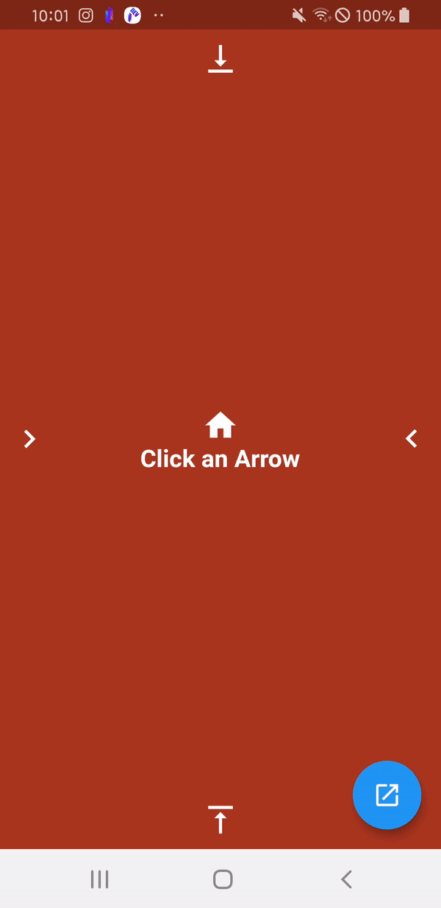

# Welcome to Nav 👋
[](https://pub.dev/packages/nav)
[](https://codecov.io/gh/BansookNam/nav)
[](https://github.com/BansookNam/nav/blob/master/LICENSE)


  Provide an easy way to navigate. Includes lots of routers. Available On Android & iOS

  Nav is an **imperative navigation helper** (Navigator 1.0 sugar): context-free push/pop,
  seven built-in transitions, dialogs & bottom sheets, and a type-safe result API
  (`NavScreen<Result>` + `pushResult`). It complements — and can coexist with —
  declarative routers like go_router.




## Install

Add nav dependency on your pubspec.yaml file

```yaml
nav: ^{latest version}
```

## Usage

1. Add the `Nav` mixin on your App State

```dart
import 'package:nav/nav.dart';

class MyAppState extends State<MyApp> with Nav
```

2. Override `navigatorKey` and provide the same key you pass to `MaterialApp.navigatorKey`

```dart
class MyApp extends StatefulWidget {
  const MyApp({super.key});

  static GlobalKey<NavigatorState> navigatorKey = GlobalKey();

  @override
  MyAppState createState() => MyAppState();
}

class MyAppState extends State<MyApp> with Nav {
  @override
  GlobalKey<NavigatorState> get navigatorKey => MyApp.navigatorKey;

  @override
  Widget build(BuildContext context) {
    return MaterialApp(
      navigatorKey: navigatorKey,
      home: const MyHomePage(),
    );
  }
}
```

Because the navigator key is held globally, every `Nav` call works without a
`BuildContext`. Pass an optional `context:` argument when you need to navigate
inside a nested `Navigator`.

3. Push with a built-in animation

```dart
// Pick any animation with the NavAni enum
Nav.push(const NextScreen(), navAni: NavAni.Blink);

enum NavAni { Left, Right, Top, Bottom, Fade, Ripple, Blink }
// lowerCamelCase aliases are also available (NavAni.blink, ...);
// the uppercase values will be removed in 3.0.

// Convenience methods
Nav.pushFromRight(const NextScreen());              // iOS swipe-back by default
Nav.pushReplacement(const NextScreen());            // replace the current route
Nav.clearAllAndPush(const NextScreen());            // clear the stack, then push
Nav.pushWithRippleEffect(
  const NextScreen(),
  alignment: Alignment.bottomRight,
  offset: const Offset(10, 10),
);

// Pop helpers
Nav.pop(context);                                   // simple pop
await Nav.canPop();                                 // whether a route can be popped
Nav.clearAll();                                     // pop everything
```

4. Any push can return a value

```dart
// from the pushing screen
final result = await Nav.pushFromRight(const TopScreen());

// from the pushed screen
Nav.pop(context, result: {"key": "value", "key2": 2});
```

5. Get a **type-safe** result with the `NavScreen<Result>` mixin & `pushResult`

Add the `NavScreen<Result>` mixin to the destination screen. It fixes the
result type and exposes a typed `popResult(context, result)` method.

```dart
// A screen that returns a String result
class TopScreen extends StatelessWidget with NavScreen<String> {
  const TopScreen({super.key});

  @override
  Widget build(BuildContext context) {
    return GestureDetector(
      // result is positional; its type is enforced by NavScreen<String>
      onTap: () => popResult(context, 'Data to return'),
      child: const Text('return'),
    );
  }
}

// Push it and await the typed result (String? here)
final String? result = await Nav.pushResult(const TopScreen());
```

From a `StatefulWidget`'s `State`, call it through `widget`:

```dart
widget.popResult(context, 'Data to return');
```

### Deep links (App Links, Universal Links, custom schemes)

Describe each link as a `NavPath` and hand them to a `NavPathDelegate`.
`:name` segments are captured; the query string comes along for free.

```dart
final paths = NavPathDelegate([
  NavPath('/product/:id', (params) => ProductScreen(id: params.getInt('id')!)),
  NavPath('/user/:name', (params) => UserScreen(name: params['name']!),
      navAni: NavAni.fade),
], unknown: (params) => NotFoundScreen(uri: params.uri));

MaterialApp(
  navigatorKey: navigatorKey,
  home: const HomeScreen(),
  onGenerateRoute: paths.onGenerateRoute,
  onUnknownRoute: paths.onUnknownRoute,
);
```

`https://example.com/product/42?tab=reviews` now opens
`ProductScreen` with:

```dart
params.pathParameters;  // {id: 42}
params.queryParameters; // {tab: reviews}
params['tab'];          // 'reviews' (path parameters first, then query)
params.getInt('id');    // 42 — also getDouble / getBool
params.uri;             // the full link
```

Flutter's built-in deep linking delivers both the link that launched the app
and links that arrive while it runs to `onGenerateRoute`, so no plugin is
needed. A launch link is stacked over its matching prefixes: with `/product`
also registered, back from `/product/42` goes to `/product`, then `home`. An
unmatched launch link opens `home`.

Only the path is matched — scheme and host are ignored — and paths are tried
in order, first match wins. Links from anywhere else (push notifications,
`app_links`, a button) open with:

```dart
if (paths.canOpen(uri)) await paths.open(uri);
```

`Navigator.pushNamed('/product/42', arguments: product)` goes through the same
delegate; the argument is `params.arguments`.

#### Platform setup

**Android** — in `android/app/src/main/AndroidManifest.xml`, inside the main `<activity>`:

```xml
<meta-data android:name="flutter_deeplinking_enabled" android:value="true" />
<intent-filter android:autoVerify="true">
    <action android:name="android.intent.action.VIEW" />
    <category android:name="android.intent.category.DEFAULT" />
    <category android:name="android.intent.category.BROWSABLE" />
    <data android:scheme="https" android:host="example.com" />
</intent-filter>
```

and serve `https://example.com/.well-known/assetlinks.json` with your package
name and signing certificate SHA-256.

**iOS** — set `FlutterDeepLinkingEnabled` to `YES` in `ios/Runner/Info.plist`,
add the *Associated Domains* capability in Xcode with `applinks:example.com`,
and serve `https://example.com/.well-known/apple-app-site-association` with
your `TEAMID.bundle.id` and the paths to claim.

**Custom schemes** (`myapp://...`) — register the scheme with an Android
`<data android:scheme="myapp" />` intent filter and an iOS `CFBundleURLTypes`
entry. Flutter passes only the path, so `myapp://product/42` arrives as `/42`
(`product` is the host). Use a fixed host, `myapp://open/product/42`, and
match `/product/:id`.

The example app is wired for `navexample://open/...` and
`https://nav.example.com/...`; see `example/lib/deep_link/`.

### Global settings (optional)

```dart
Nav.init(navigatorKey, setting: NavSetting(useRootNavigator: true, useSafeArea: false));
```

`Nav.init` is also an alternative to the mixin: call it once with the key you
pass to `MaterialApp.navigatorKey` and skip mixing `Nav` into your App State.

### Widget tests

`package:nav/testing.dart` ships a ready-made harness so you don't need to
wire up a navigator key in every test:

```dart
import 'package:nav/testing.dart';

await tester.pumpWidget(NavAppForTesting(child: MyScreen()));
Nav.push(const NextScreen()); // works immediately
```


## Migrating from 1.x

2.0 is a major release. Apps on `nav: ^1.4.3` keep getting 1.x until they
change the constraint to `^2.0.0`. Work through the steps below in order; the
first one fixes most compile errors on its own.

### 1. Import the barrel library

1.x shipped its classes as public files, and `package:nav/nav.dart` exported
only `Nav` and `NavAni`. Every implementation file now lives under
`lib/src/`, so any import of a deep path no longer compiles.

| 1.x import | 2.0 import |
| --- | --- |
| `package:nav/dialog/dialog.dart` | `package:nav/nav.dart` |
| `package:nav/dialog/dialog_state.dart` | `package:nav/nav.dart` |
| `package:nav/bottom_sheet/modal_bottom_sheet.dart` | `package:nav/nav.dart` |
| `package:nav/route/*.dart` | `package:nav/nav.dart` |
| `package:nav/enum/enum_nav_ani.dart` | `package:nav/nav.dart` |
| `package:nav/screen/nav_screen.dart` | `package:nav/nav.dart` |
| `package:nav/setting/nav_setting.dart` | `package:nav/nav.dart` |
| `package:nav/test/nav_app_for_testing.dart` | `package:nav/testing.dart` |

`MutableValue` and `CircularRevealClipper` were internal and are no longer
public.

### 2. Rename route classes

| 1.x | 2.0 |
| --- | --- |
| `SlideFromLeftRoute(screen)` | `SlideRouteBuilder.fromLeft(screen)` |
| `SlideFromRightRoute(screen)` | `SlideRouteBuilder.fromRight(screen)` |
| `SlideFromTopRoute(screen)` | `SlideRouteBuilder.fromTop(screen)` |
| `SlideFromBottomRoute(screen)` | `SlideRouteBuilder.fromBottom(screen)` |
| `FadeRoute(screen)` | `FadeRouteBuilder(screen)` |
| `BlinkRoute(screen)` | `BlinkRouteBuilder(screen)` |
| `RoundRevealRoute(screen, ...)` | `RippleRouteBuilder(screen, ...)` — same parameters; when both `centerAlignment` and `centerOffset` are given, the alignment wins |

### 3. Replace removed members

These were deprecated in 1.4.3. Their deprecation notices said they would be
removed in 3.0; they were removed in 2.0 instead, together with the other
breaking changes, so that there is a single migration.

| 1.x | 2.0 |
| --- | --- |
| `Nav.pushFromLeft(screen)` | `Nav.push(screen, navAni: NavAni.left)` |
| `Nav.pushFromTop(screen)` | `Nav.push(screen, navAni: NavAni.top)` |
| `Nav.pushFromBottom(screen)` | `Nav.push(screen, navAni: NavAni.bottom)` |
| `Nav.popResultSuccess(context)`, `popResultFail`, `popResultCancel`, `popResultDelete`, `popResultRefresh` | `popResult(context, value)` from a `NavScreen<Result>` |
| `Nav.isSuccess(result)`, `isFail`, `isCancel`, `isDeleted`, `isRefresh` | compare the typed value returned by `Nav.pushResult` |
| `Nav.RESULT`, `SUCCESS`, `FAIL`, `CANCEL`, `DELETED`, `REFRESH` | your own result type |

The string-map results become a type you own:

```dart
// 1.x
final result = await Nav.pushFromRight(const EditScreen());
if (Nav.isSuccess(result)) refresh();
// ...and in EditScreen
Nav.popResultSuccess(context);

// 2.0
enum EditResult { saved, deleted }

class EditScreen extends StatelessWidget with NavScreen<EditResult> {
  // ...
  onTap: () => popResult(context, EditResult.saved),
}

final result = await Nav.pushResult(const EditScreen()); // EditResult?
if (result == EditResult.saved) refresh();
```

The 1.x README showed `popResult(context, result: value)`; the method has
always taken the value positionally: `popResult(context, value)`.

### 4. Smaller signature changes

| 1.x | 2.0 |
| --- | --- |
| `if (await Nav.canPop())` | `if (Nav.canPop())` — now a synchronous `bool` |
| `Nav.push(maybeNullScreen)` returned null for a null screen | `push`, `pushReplacement`, `clearAllAndPush`, `pushFromRight` and `pushWithRippleEffect` take a non-null `Widget`; check for null before the call |
| `dialog.isShown.value` | `dialog.isShown` |

### 5. Behavior changes to check

- `DialogWidget(useSafeArea: ...)` is now honored. In 1.x it was silently
  replaced by the `useRootNavigator` value, so a dialog that passed one value
  and relied on the other may lay out differently.
- `ModalBottomSheet(isScrollControlled: false)` is now honored. In 1.x
  `show()` always used `true`. The default is still `true`.
- Using `Nav` before it is initialized now throws a `StateError` that says how
  to initialize it, instead of a `LateInitializationError`.

The uppercase `NavAni` values (`NavAni.Left`, ...) still work in 2.x; switch
to the lowercase aliases before 3.0.

## Releasing

Releases are published to pub.dev by GitHub Actions when a `v<version>` tag is
pushed — no token is stored anywhere; pub.dev trusts the workflow over OIDC.

1. Bump `version:` in `pubspec.yaml` and add a matching `## [<version>]`
   section to `CHANGELOG.md`.
2. Merge to `master`, then tag and push: `git tag v2.0.0 && git push origin v2.0.0`.

`.github/workflows/publish.yml` refuses to publish unless the tag, the pubspec
and the changelog agree, and the analyzer, the tests and a publish dry run all
pass.

## Test Coverage

The library is tested at **100% line coverage**, verified on every push by
[Codecov](https://app.codecov.io/gh/BansookNam/nav). Each slice of the graph
below is a source file — click it to explore the full interactive report.

[](https://app.codecov.io/gh/BansookNam/nav)

## Author

👤 **Bansook Nam**

* Website: https://github.com/bansooknam
* Github: [@bansooknam](https://github.com/bansooknam)

## 🤝 Contributing

Contributions, issues and feature requests are welcome!

Feel free to check the [issues page](https://github.com/bansooknam/nav/issues).

## Show your support

Give a ⭐️ if this project helped you!


## 📝 License

Copyright © 2020 [Bansook Nam](https://github.com/bansooknam).

This project is [Apache 2.0](https://github.com/BansookNam/nav/blob/master/LICENSE) licensed.

***
_This README was generated with ❤️ by [readme-md-generator](https://github.com/kefranabg/readme-md-generator)_
